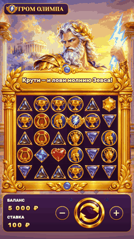
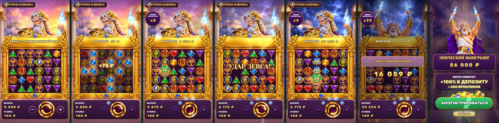
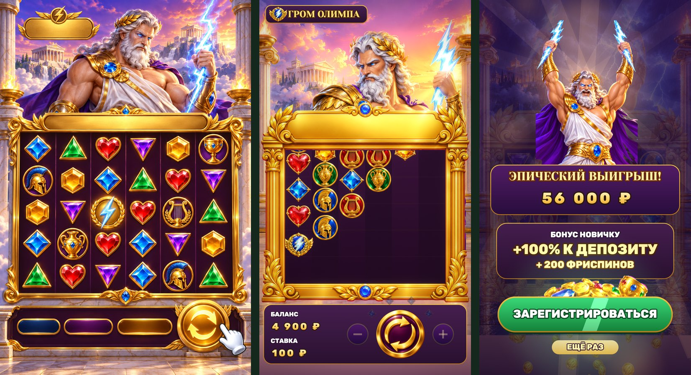

# Гром Олимпа — слот-playable для онлайн-казино

**▶ Играть в браузере / с телефона:** https://bankaino.github.io/olympus-slot-playable/
(A/B-варианты: [fast3](https://bankaino.github.io/olympus-slot-playable/fast3.html), [nodeposit_fs](https://bankaino.github.io/olympus-slot-playable/nodeposit_fs.html)). Тап в любое место — SPIN; в онлайн-версии звук без музыкального трека (только эффекты).

<p align="center"><br><sub>демо-прогон, 27 с</sub></p>

Портретная 2D playable-реклама слота с каскадом «платит везде» для вымышленного онлайн-казино «Амброзия» (**концепт**: бренд, бонус, выигрыши и сам слот вымышлены). Четыре заранее расписанных спина: проигрыш → небольшой выигрыш → средний (первая молния Зевса) → «Удар Зевса», каскад из четырёх падений, три сферы-множителя x5, x10, x10 (общий x25) и big win на 56 000 ₽ с титулами «БОЛЬШОЙ → МЕГА → ЭПИЧЕСКИЙ». В конце эндкард с оффером и кнопкой «Зарегистрироваться».

Весь пайплайн — от референса до билдов — пройден собственными скиллами для Claude Code.



От концепт-кадра до игры (слева сгенерированный концепт, дальше кадры игры):



## Как играть

1. Выбери ставку кнопками **−** и **+** по бокам от SPIN, справа внизу (20, 40, 100, 200, 400, 1 000 ₽; по умолчанию 100 ₽; слева на панели баланс и текущая ставка) и тапни в любое место экрана — барабаны крутятся. Руки-подсказки хватает на первый спин.
2. Восемь и больше одинаковых символов где угодно на поле — выигрыш. Общий выигрыш считается на золотой плашке над полем: сначала растёт сумма каскада, потом она умножается на сферы по мере их ударов. Выигравшие символы взрываются, сверху падают новые, каскад идёт, пока есть выигрыши.
3. Зевс «заряжается» с каждым спином (четыре камня вокруг кнопки). На четвёртом спине кнопка загорается золотом: «Удар Зевса».
4. Игра ждёт твоего тапа и сама не крутит. Тап во время розыгрыша ускоряет его (×1.4), тап во время big win после третьего титула показывает итог.

Один палец, никаких жестов. Таймеров нет: игра ждёт тапа сколько угодно, и до первого касания, и между спинами. Эндкард показывается только после финального big win. Для размещения в рекламных сетях правило «эндкард всегда» возвращается двумя числами в `variants/*.json` (`"K": { "END_NO_INPUT": 12, "END_IDLE": 20 }`: секунд до первого касания и секунд ожидания между спинами).

## Что внутри за ~25 секунд (демо-прогон)

| время | бит | что видит зритель |
|---|---|---|
| 0–1.5 с | хук | закат над Олимпом, дышащий Зевс с молнией в кулаке, плашка «Крути — и лови молнию Зевса!», рука у кнопки SPIN |
| 1.5–3.7 с | спин 1 | символы падают колонками; проигрыш, Зевс качает головой, на поле «почти» шлемы (7 из 8) |
| 3.7–6 с | спин 2 | десять синих → золотые рамки, взрыв, «+75 ₽», затем восемь красных; 175 ₽ монетами летят в баланс |
| 6.5–11.5 с | спин 3 | на поле сфера x5: Зевс бьёт молнией, общий множитель 5, 280 × 5 = 1 400 ₽, «ОТЛИЧНО!», небо темнеет |
| ~11.5 с | заряд | четыре камня горят, кнопка золотая: «УДАР ЗЕВСА!» |
| ~12.9 с | вау | белая вспышка, гром и тряска, музыка срывается в «дроп» |
| 13–20 с | каскад | лира ×10, синие ×12, шлемы ×9, зелёные ×8; на поле сферы x5, x10, x10: три молнии, множитель растёт до x25 |
| 20.3–24.5 с | big win | Зевс поднимает обе руки с молниями, дождь монет, счётчик 0 → 56 000 ₽, три титула со вспышками |
| ~24.8 с | эндкард | выигрыш, «БОНУС НОВИЧКУ +100% К ДЕПОЗИТУ + 200 ФРИСПИНОВ», кнопка на весь экран, «Ещё раз» |

Тексты эндкарда для случаев по таймеру («Испытай удачу Олимпа», «Зевс ждёт тебя!») остаются в игре на случай, если таймеры включить.

## Математика выигрыша

Выигрыш — не картинка, а расчёт. Группа из ≥ 8 одинаковых символов платит **множитель по таблице × ставка**; за каскад суммы всех групп складываются; в конце сумма умножается на **сумму значений сфер** на поле.

| символ | 8–9 шт. | 10–11 шт. | 12+ шт. |
|---|---|---|---|
| шлем | 10× | 20× | 50× |
| лира | 3× | 10× | 25× |
| амфора | 2× | 6× | 15× |
| кубок | 1.5× | 3× | 12× |
| красное сердце | 1× | 2× | 10× |
| фиолетовый | 0.8× | 1.5× | 8× |
| жёлтый | 0.5× | 1× | 5× |
| зелёный | 0.4× | 0.8× | 4× |
| синий | 0.3× | 0.75× | 2× |

Сценарий в кратных ставки: спин 1 — 0×; спин 2 — (синие ×10 → 0.75×) + (красные ×8 → 1×) = **1.75×**; спин 3 — (фиолетовые ×9 → 0.8×) + (амфоры ×8 → 2×) = 2.8×, сфера x5 → **14×**; спин 4 — лира ×10 (10×) + синие ×12 (2×) + шлемы ×9 (10×) + зелёные ×8 (0.4×) = 22.4×, сферы 5 + 10 + 10 = x25 → **560×**. При ставке 100 ₽ это 0 / 175 / 1 400 / 56 000 ₽, при ставке 1 000 ₽ — 0 / 1 750 / 14 000 / 560 000 ₽. Ставка списывается при каждом спине, выигрыш зачисляется на баланс (старт 5 000 ₽). Титулы big win считаются от ставки: «БОЛЬШОЙ» ≥ 20×, «МЕГА» ≥ 100×, «ЭПИЧЕСКИЙ» ≥ 300×.

`node tools/script_check.mjs` проверяет эту арифметику: 20 зёрен × 4 лестницы ставок (включая ступенчатую, переключаемую настоящим вводом «+»), выигрыш каждого спина должен быть равен множитель × ставка, а баланс — сойтись до рубля.

## A/B-варианты

Игровая часть везде одна и та же, меняется только то, что видит большинство сессий:

| вариант | что меняется | гипотеза |
|---|---|---|
| `classic4` (основной) | четыре спина: проигрыш → мало → средне → big win | игрок успевает «поверить» в слот и увидеть всю лестницу выигрышей |
| `fast3` | без проигрышного спина, три спина | первый выигрыш уже на первом спине, путь до big win короче на ~2 с, больше досмотров до эндкарда |
| `nodeposit_fs` | оффер «200 ФРИСПИНОВ БЕЗ ДЕПОЗИТА» вместо «+100% К ДЕПОЗИТУ» | «без депозита» конвертит в регистрацию лучше |

Сравнивать стоит CTR эндкарда, долю досмотра до эндкарда и долю повторов (`Ещё раз`).

## Темп (прогон 300 «зрителей» без браузера)

`node tools/bots.mjs 300` — боты тапают с человеческими задержками; 10 % спамеры, 15 % перестают тапать после второго спина, 5 % бросают после первого, 8 % не касаются экрана. Бросившие и не касавшиеся просто ждут: эндкарда у них нет, пока они не доиграют. Исход рекламы от навыка не зависит (он расписан), поэтому коридоры про **темп**:

| метрика | `classic4` | `fast3` | коридор |
|---|---|---|---|
| играющие дошли до эндкарда | 100 % | 100 % | 100 % |
| от первого тапа до эндкарда у играющих, медиана | 21.4 с | 20.1 с | 21–26 / 15–21 с |
| p95 у играющих | 22.3 с | 20.2 с | ≤ 34 с |
| спамер проходит шоу не быстрее | 18.1 с | 17.1 с | ≥ 18 / ≥ 14 с |
| big win на экране, минимум | 4.0 с | 4.0 с | ≥ 3.5 с |
| играющие, оборванные посреди шоу | 0 | 0 | 0 |

Сценарий проверяет `node tools/script_check.mjs`: генератор раскладок собирает поле так, что настоящий движок каскада выдаёт ровно 0 / 175 / 1 400 / 56 000 ₽ на любом зерне (20 зёрен, «Ещё раз» меняет картинки, но не исходы).

## Картинка

Все слои — сгенерированные спрайты (ChatGPT image gen): Зевс в двух позах, золотая рамка с окном, закат и гроза, камни, медальоны, сферы-множители, кнопка, монета, рука, сокровища. Зевс — один рисунок: рука с молнией, голова и торс гнутся «мягкими костями» (карта весов, без разрезов), поэтому он дышит, кивает на выигрыш, мотает головой на проигрыш и замахивается на удар. Молнии, свечения, взрывы, дождь, лучи, монетный фонтан, цифры и тексты рисуются кодом. Раскладка снята с самой рамки (окно → клетка 136 px), поэтому поле подстраивается под любой телефон от 16:9 до 19.5:9.

## Звук

Эффекты (спин, приземления по колонкам с растущим тоном, аккорды выигрыша, монеты, заряд Зевса, титулы, тики счётчика) синтезируются кодом. Удар молнии — записанный сэмпл (Pixabay, свободная лицензия, ~1 с): на каждый удар проигрывается как есть, на «Удар Зевса» тройным слоем с замедлением (глубже и дольше). Синтезированный гром остался как запасной вариант: `?thunder=synth` в адресе включает его для сравнения. Музыкальная подложка собирается из трёх клипов `live/audio/music_loop|drop|epic.mp3` (петля под первые спины → «дроп» на удар Зевса → финал на big win); в репозиторий они не входят, онлайн-демо играет без музыки. Без файлов игра работает на одних эффектах.

## Билды под рекламные сети

```bash
python3 tools/build_playable.py --variant all
```

Каждый билд — один HTML-файл без внешних запросов (ZIP для Google): код, спрайты (WebP), музыка (base64) и адаптер сети.

| сеть | размер | лимит | CTA / жизненный цикл |
|---|---|---|---|
| AppLovin | 1.80 MB | 5 MB | `mraid.open` |
| Unity Ads | 1.80 MB | 5 MB | `mraid.open` |
| ironSource | 1.80 MB | 5 MB | `dapi.openStoreUrl` |
| Mintegral | 1.80 MB | 5 MB | `install()`, `gameReady()`, `gameEnd()` |
| Google Ads | 1.30 MB (zip) | 5 MB | `ExitApi.exit()` |
| Meta | 1.80 MB | 2 MB | `FbPlayableAd.onCTAClick()` |

Из 1.8 MB: спрайты 0.95 MB (1.27 MB в файле после base64), музыка 0.28 MB (0.37 MB в файле), код и шрифты ~0.14 MB. Meta — самый тесный лимит, запас около 10 %. Подробности — в `dist/<вариант>/report.md`. Ссылка регистрации в `tools/build.json` — заглушка (`https://example.com/register`), перед отправкой в сети её нужно заменить.

## Проверка

```bash
node tools/script_check.mjs 20          # сценарий × ставки на 20 зёрнах
node tools/bots.mjs 300                 # темп на ботах (--k SCRIPT_ID=fast3 для второго варианта)
node tools/smoke_test.mjs dist/classic4/applovin.html   # телефонный прогон: загрузка, тап по SPIN, настоящее касание, эндкард, CTA, fps
node tools/bet_probe.mjs                # кнопки − / + и SPIN настоящими кликами: ставка, баланс и формула выигрыша
node tools/audio_probe.mjs              # музыка и эффекты в headless: клипы декодируются, режимы переключаются, пик без клиппинга
```

Смоук-тест открывает билд на экране 390×844 и падает при ошибках страницы, внешних запросах, fps < 50 или если CTA не вызвал `mraid.open`. На последнем прогоне — 61 fps. Звук проверялся машиной (уровни, переключения), не на слух.

> Это концепт для портфолио: бренд «Амброзия», слот, бонус и выигрыши вымышлены. В самой игре нет возрастной маркировки и юридических строк; реальная реклама азартных игр требует лицензии оператора, маркировки и сертификации в каждой рекламной сети.
